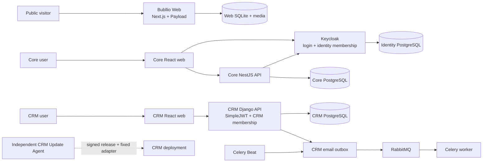

# Bubllio suite architecture

Status: current implementation and target integration, 2026-10-29. This page
answers how the Bubllio repositories fit together. The owning repository's
documentation remains authoritative for each product's detailed behavior.

## What runs today

These are independent products and data stores. **CRM does not currently sign
in through Keycloak or call Core for app access.** Its Django users,
organizations, memberships, invitations, and SimpleJWT tokens remain the
authority for shipped CRM requests. Core's first-run and access API are a
technical-alpha foundation. Board is planned and has no running product here.

Web is the public site and CMS. Its Payload users and data are for site
administration; they are not Core or CRM accounts. Its SQLite database and
uploaded media use a separate durable volume.

## Systems of record

| Concern | Authority today | Intended suite boundary |
| --- | --- | --- |
| Core login, sessions, verification, identity membership | Keycloak | Keycloak for integrated apps |
| Core product organization, app catalog, availability, grants, installation state | Core API + Core database | Core |
| CRM login and account recovery | Django + SimpleJWT | Additive migration to Keycloak; not shipped |
| CRM workspace membership, roles, invitations | Django CRM | Migrate shared membership carefully; CRM keeps domain permissions |
| CRM companies, contacts, deals, activities, subscriptions, billing | Django CRM database | CRM remains the domain owner |
| Public pages, media, CMS accounts | Bubllio Web + Payload | Web remains separate |
| CRM update jobs and deployment credentials | Independent Update Agent | Independent from Django request process |

A CRM `Organization`, a Core product organization, and a Keycloak identity
organization are distinct records today. No email address or display name is a
safe cross-system key. The target integration uses immutable external IDs and a
tested mapping; it must not merge databases or silently reinterpret existing
CRM tenant IDs.

## Request and authorization paths

### Shipped CRM path

The CRM browser calls the versioned Django `/api/v1/` contract through its
feature hooks and Axios client. Django authenticates its own access token,
resolves the route organization through the caller's Django membership and
capability, and filters the queryset by that organization. A route ID is a
lookup input, never proof of access. Refresh-token rotation and logout belong
to Django. New CRM accounts enter through a Django invitation; there is no
general public signup endpoint.

### Core path and target app integration

Core web uses Keycloak Authorization Code with PKCE. Core validates the token
and exact identity-organization membership, then applies its product
organization state and per-member app grant. Its workspace lists only granted
apps, but hiding an app in the launcher is not an authorization check.

The intended integrated app backend must validate its own Keycloak token and
organization context, ask Core's versioned access API for the exact app key,
organization, and subject, and then enforce its own domain permissions. It
must deny tenant access if Core denies or an allowed cache window expires.
Core publishes the [access contract](../contracts/core-access-v1.openapi.yaml);
the standard adapter and CRM adoption are still pending. Existing CRM APIs
must keep working during any additive migration.

## Core first run and member enrollment

The portable Core installation contract starts the databases, Keycloak, Core
API/web, migration job, and private identity setup agent through a platform
adapter. Its browser flow checks dependencies, proves SMTP delivery with a
short-lived email code, creates the first verified Keycloak account, and
requires that subject plus a one-time out-of-band setup secret before claiming
the installation. Core then creates and reconciles the first product and
identity organizations, owner membership, and fresh organization-bearing
session. Durable operation state permits retry without creating a second
organization.

Public Keycloak registration is temporary during that first administrator
ceremony. The current implementation closes it at the verified secret claim;
later users require an organization invitation. Core's member invitation and
grant administration UI is **not shipped** in this technical alpha. The CRM's
existing Django invitation is a separate flow and must not be presented as a
Core/Keycloak invitation. Existing Core installations initialized by older
builds may require a one-time Keycloak realm setting change; see the
[first-run runbook](../operations/first-run.md).

## Data, messaging, and deployment

- Core, Keycloak, CRM, and Web have separate persistent stores. Apps never read
  one another's databases. Backups and restores must cover each relevant store
  and its matching configuration and secret lifecycle.
- CRM transactional email uses a PostgreSQL outbox as the durable record,
  RabbitMQ to carry job IDs, a Celery worker for delivery/retry, and Celery Beat
  for due or stale-job recovery. A worker crash after send can produce a rare
  duplicate. Core's installation email test uses its isolated setup agent and
  Keycloak SMTP vault; it is not the CRM mail pipeline.
- Core's technical-alpha GitHub workflow tests and publishes digest-pinned
  GHCR images and promotes a managed Compose manifest. Manifest promotion does
  not prove that Dokploy or any other host pulled and started those digests.
  The portable installation contract is the source; Dokploy is an adapter.
- CRM has its own signed release policy and independent, HMAC-authenticated
  Update Agent. The agent validates the manifest, version range, image digests,
  migration class, and fixed deployment adapter before an eligible update.
  Django never receives Docker access. Maintenance and irreversible updates
  remain operator-managed.
- Web deploys separately as a Next.js/Payload application. Its public CMS and
  release cycle do not change Core or CRM authorization.

## Security, privacy, and unfinished work

The browser never receives machine credentials, SMTP passwords, setup secrets
after use, or another application's database access. Each backend enforces its
own authentication and tenant rules. Cross-system personal-data transfers need
an explicit purpose, minimum fields, retention, deletion, audit, and processor
review; technical-alpha tests are not privacy or production approval.

The main integration gaps are CRM's additive identity/access migration, a
standard app backend adapter and conformance tests, Core member administration,
backup/restore and recovery evidence, and production privacy/security gates.
Board remains planned. Human product, engineering, and privacy/legal decision
owners must approve release criteria separately; this document records the
architecture and current limits, not those approvals.

## Detailed sources

- [Core identity and organizations](identity-and-organizations.md),
  [organization security](organization-security.md),
  [cross-app contract](cross-app-contracts.md), and
  [deployment](../deployment/README.md).
- CRM's `docs/architecture/system-overview.md`,
  `docs/architecture/authentication-and-roles.md`,
  `docs/architecture/email-adapters.md`, and
  `docs/development/updating.md` in the `bubllio-crm` repository.
- Web's `README.md` and `PRODUCT.md` in the `bubllio-web` repository.
- Workspace `docs/ecosystem-map.md` for repository routing and
  `docs/cross-project-changes.md` for multi-repository changes.
